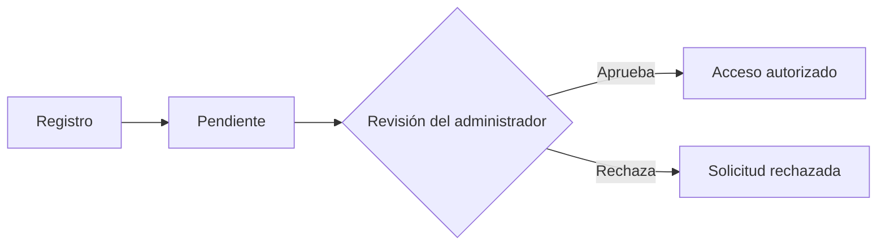
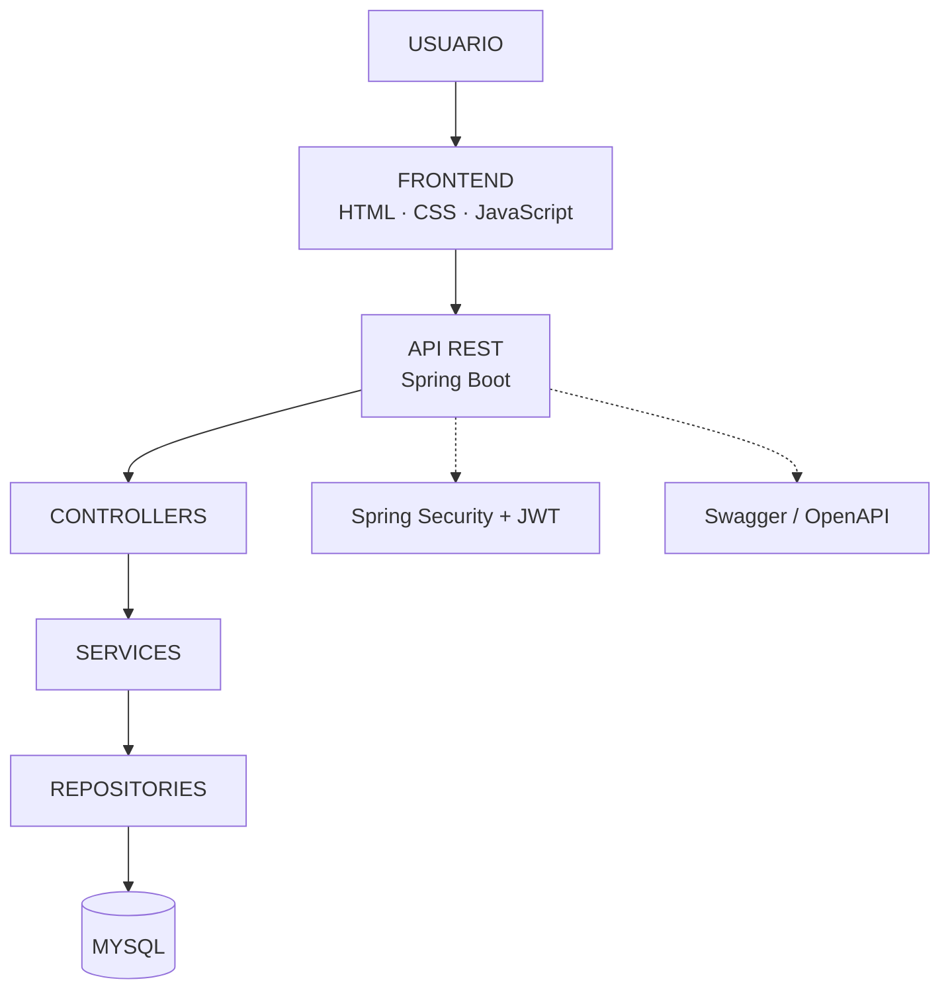

<!-- ================================================== -->
<!--                    BAKE TRACK                    -->
<!-- ================================================== -->

<div align="center">


# BAKE TRACK

### SISTEMA DE GESTIÓN Y CONTROL DE INVENTARIO

**La organización detrás de cada ingrediente.**

Una plataforma web para administrar productos, bodegas, existencias y movimientos de inventario de una panadería.

<br>

<a href="#sobre-el-proyecto"></a>
<a href="#instalación"></a>
<a href="#documentación-api"></a>

<br><br>


</div>

---

<div align="center">

## UNA FORMA MÁS INTELIGENTE DE GESTIONAR

| **11** | **MÓDULOS** | **1** | **PLATAFORMA CENTRALIZADA** |
|:---:|:---:|:---:|:---:|
| Áreas funcionales | Gestión integral | Sistema web | Información organizada |

</div>

---

## ÍNDICE

| | Sección | | Sección |
|:---:|---|:---:|---|
| 01 | [Sobre el proyecto](#01--sobre-el-proyecto) | 07 | [Arquitectura](#07--arquitectura-del-sistema) |
| 02 | [Objetivos](#02--objetivos) | 08 | [Estructura](#08--estructura-del-proyecto) |
| 03 | [Funcionalidades](#03--funcionalidades) | 09 | [Base de datos](#09--base-de-datos) |
| 04 | [Tecnologías](#04--tecnologías) | 10 | [Instalación](#10--instalación) |
| 05 | [Seguridad](#05--seguridad) | 11 | [Documentación API](#11--documentación-api) |
| 06 | [Módulos](#06--módulos-del-sistema) | 12 | [Autora](#12--autora) |

---

<a id="01--sobre-el-proyecto"></a>

# 01 / SOBRE EL PROYECTO

### Una solución digital para el control de inventarios.

**Bake Track** es una aplicación web desarrollada para facilitar la administración y el seguimiento de inventarios en una panadería.

La plataforma centraliza la información de productos, marcas, categorías, bodegas y existencias. Permite registrar entradas, salidas y transferencias, consultar reportes y realizar seguimiento de las operaciones efectuadas por los usuarios.

Su propósito es ofrecer una herramienta organizada que contribuya al control de los recursos y a la gestión de las actividades diarias del inventario.

<div align="center">

| GESTIÓN | CONTROL | TRAZABILIDAD |
|:---:|:---:|:---:|
| Administración centralizada | Seguimiento de existencias | Registro de operaciones |

</div>

---

<a id="02--objetivos"></a>

# 02 / OBJETIVOS

### Objetivo general

Desarrollar un sistema web para gestionar y controlar el inventario de una panadería, permitiendo administrar productos, bodegas, existencias y movimientos, con mecanismos de autenticación, autorización y trazabilidad de las operaciones.

### Objetivos específicos

- Administrar la información de productos, marcas y categorías.
- Gestionar bodegas y controlar su capacidad.
- Consultar y supervisar las existencias de productos.
- Registrar entradas, salidas y transferencias de inventario.
- Generar consultas y reportes para facilitar el seguimiento.
- Gestionar usuarios y permisos de acceso.
- Mantener un registro de las actividades realizadas en el sistema.

---

<a id="03--funcionalidades"></a>

# 03 / FUNCIONALIDADES

El sistema integra diferentes herramientas para administrar los procesos relacionados con el inventario.

<details open>
<summary><strong>01 — Administración de información</strong></summary>

- Gestión de usuarios.
- Administración de productos.
- Gestión de marcas.
- Clasificación por categorías.
- Administración de ciudades.
- Gestión de bodegas.

</details>

<details open>
<summary><strong>02 — Control de inventario</strong></summary>

- Consulta general de existencias.
- Consulta por producto.
- Consulta por bodega.
- Identificación de productos con stock bajo.
- Resumen de existencias por bodega.

</details>

<details open>
<summary><strong>03 — Movimientos de inventario</strong></summary>

- Registro de entradas.
- Registro de salidas.
- Transferencias entre bodegas.
- Consulta por usuario.
- Consulta por tipo de movimiento.
- Consulta por bodega.
- Consulta por rango de fechas.

</details>

<details open>
<summary><strong>04 — Reportes y auditoría</strong></summary>

- Reporte general de inventario.
- Reportes por producto y bodega.
- Consulta de stock bajo.
- Resumen de inventario por bodegas.
- Productos con mayor movimiento.
- Seguimiento de actividades registradas.

</details>

---

<a id="04--tecnologías"></a>

# 04 / TECNOLOGÍAS

### Herramientas que hacen posible Bake Track.

<div align="center">

| BACKEND | FRONTEND | BASE DE DATOS |
|:---:|:---:|:---:|
| Java | HTML5 | MySQL |
| Spring Boot | CSS3 | |
| Spring Web | JavaScript | |
| Spring Data JPA | | |
| Spring Security | | |
| JWT | | |
| Maven | | |

<br>

**Herramientas complementarias**


</div>

---

<a id="05--seguridad"></a>

# 05 / SEGURIDAD

### Acceso controlado y administración de usuarios.

Bake Track implementa autenticación mediante JWT y autorización basada en roles.

| ROL | RESPONSABILIDAD |
|---|---|
| **ADMIN** | Administración de usuarios y funcionalidades administrativas del sistema. |
| **EMPLEADO** | Acceso a las funcionalidades habilitadas según sus permisos. |

### Proceso de aprobación de usuarios



Los usuarios registrados permanecen pendientes hasta que el administrador revise y resuelva su solicitud.

---

<a id="06--módulos-del-sistema"></a>

# 06 / MÓDULOS DEL SISTEMA

### Una plataforma, diferentes áreas de gestión.

| MÓDULO | FUNCIÓN |
|---|---|
| Usuarios | Registro y administración de cuentas. |
| Autenticación | Inicio de sesión y validación de acceso. |
| Productos | Gestión de productos. |
| Marcas | Administración de marcas. |
| Categorías | Organización de productos. |
| Ciudades | Gestión de ciudades. |
| Bodegas | Administración de bodegas y capacidad. |
| Inventario | Control de existencias. |
| Movimientos | Entradas, salidas y transferencias. |
| Reportes | Consultas de inventario y movimientos. |
| Auditoría | Seguimiento de actividades registradas. |

---

<a id="07--arquitectura-del-sistema"></a>

# 07 / ARQUITECTURA DEL SISTEMA

### Organización por capas

El backend está estructurado mediante una arquitectura por capas que separa las responsabilidades y facilita el mantenimiento del código.



### Responsabilidad de cada capa

| CAPA | RESPONSABILIDAD |
|---|---|
| Controller | Recibe las solicitudes HTTP y entrega respuestas. |
| Service | Gestiona la lógica de negocio. |
| Repository | Realiza las operaciones de acceso a datos. |
| Model | Representa las entidades del sistema. |
| DTO | Estructura la información intercambiada entre componentes. |
| Auth | Agrupa los componentes de autenticación y seguridad. |

---

<a id="08--estructura-del-proyecto"></a>

# 08 / ESTRUCTURA DEL PROYECTO

### Organización del código

La estructura general del backend se distribuye por responsabilidades:

```text
BAKE-TRACK/
│
├── src/
│   └── main/
│       ├── java/
│       │   ├── auth/
│       │   ├── controller/
│       │   ├── dto/
│       │   │   ├── request/
│       │   │   └── response/
│       │   ├── model/
│       │   ├── repository/
│       │   └── service/
│       │
│       └── resources/
│           └── application.properties
│
├── frontend/
│   ├── assets/
│   ├── fonts/
│   ├── archivos HTML
│   ├── archivos CSS
│   └── archivos JavaScript
│
├── mvnw
├── mvnw.cmd
├── pom.xml
└── README.md
```

*La estructura del frontend es ilustrativa y debe ajustarse a las carpetas reales del repositorio.*

---

<a id="09--base-de-datos"></a>

09 / BASE DE DATOS

MySQL — Gestión y almacenamiento de información

Bake Track utiliza MySQL como sistema de gestión de bases de datos.

Nombre de la base de datos

logitrack_sararami

Entidades principales

Usuario

Producto

Marca

Categoría

Ciudad

Bodega

Inventario

Movimiento

Auditoría

Configuración de conexión

La conexión se configura en:

src/main/resources/application.properties

Ejemplo:

spring.datasource.url=jdbc:mysql://localhost:3306/logitrack_sararami
spring.datasource.username=TU_USUARIO
spring.datasource.password=TU_CONTRASEÑA

spring.jpa.hibernate.ddl-auto=update
spring.jpa.show-sql=true

Importante: utiliza tus propias credenciales locales. Nunca publiques contraseñas reales en GitHub.

<a id="10--instalación"></a>

10 / INSTALACIÓN

Cómo ejecutar Bake Track en un entorno local

Requisitos previos

Java instalado.

MySQL instalado y activo.

Git.

Visual Studio Code o un entorno compatible.

Navegador web.

PASO 01 — Clonar el repositorio

git clone https://github.com/whoissarisss/LogiTrackBySaris.git

PASO 02 — Ingresar al proyecto

cd LogiTrackBySaris

PASO 03 — Crear la base de datos

CREATE DATABASE logitrack_sararami;

PASO 04 — Configurar la conexión

Editar el archivo:

src/main/resources/application.properties

Agregar las credenciales correspondientes a la instalación local.

PASO 05 — Compilar

En Windows:

.\mvnw.cmd clean compile

PASO 06 — Ejecutar el backend

.\mvnw.cmd spring-boot:run

El backend se ejecutará en:

http://localhost:8080

PASO 07 — Ejecutar el frontend

Abrir el frontend con Live Server desde Visual Studio Code o mediante un servidor web local.

<a id="11--documentación-api"></a>

11 / DOCUMENTACIÓN API

Swagger — Exploración de servicios REST

Bake Track incorpora Swagger / OpenAPI para consultar y probar los servicios disponibles.

<div align="center">

<a href="http://localhost:8080/swagger-ui/index.html">


</a>

Dirección local:

http://localhost:8080/swagger-ui/index.html

</div>

Controladores documentados

CONTROLADOR

DESCRIPCIÓN

Usuario Controller

Administración de usuarios.

Producto Controller

Gestión de productos.

Marca Controller

Gestión de marcas.

Ciudad Controller

Administración de ciudades.

Categoría Controller

Clasificación de productos.

Bodega Controller

Administración de bodegas.

Movimiento Controller

Registro y consulta de movimientos.

Auth Controller

Autenticación.

Inventario Controller

Consultas de existencias.

Auditoría Controller

Consulta de actividades.

Reporte Controller

Consultas y reportes del sistema.

<a id="12--autora"></a>

12 / AUTORA

<div align="center">

SARAI ANDREA PEDRAZA ROSAL

Desarrollo y construcción del proyecto Bake Track.

Proyecto académico de desarrollo de software.

<br>

BAKE TRACK

Gestión organizada para una mejor administración del inventario.


</div>
