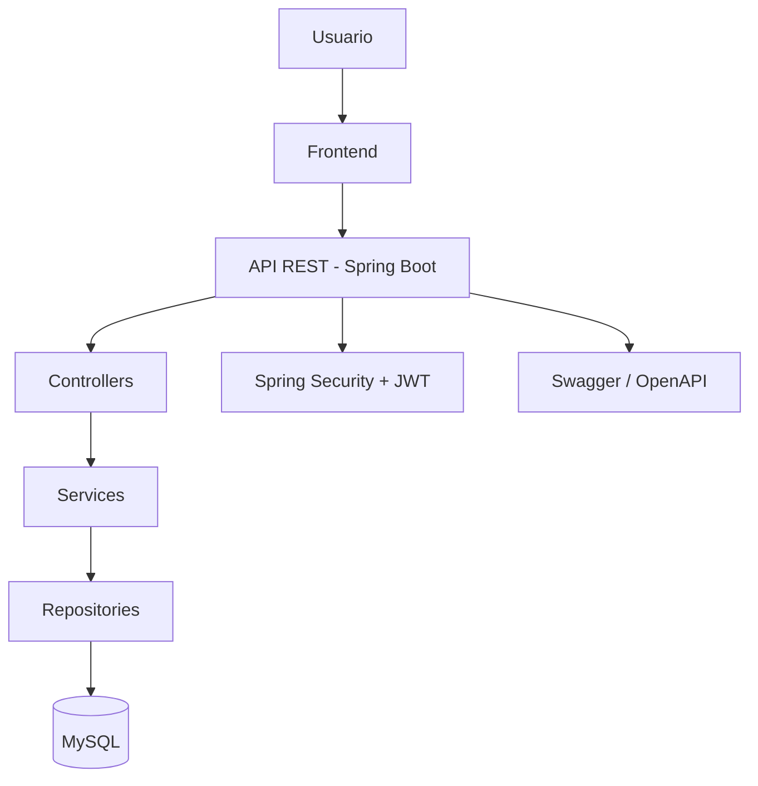

# BAKE TRACK

### Sistema web de gestión y control de inventario para panaderías

\<p align="center">   \<strong>Organiza. Controla. Administra.\</strong>   \<br>   Una solución web para gestionar productos, bodegas, existencias y movimientos de inventario de manera centralizada. \</p>

\<p align="center">   \ \</p>

\<p align="center">   \   \   \   \   \ \</p>

---

## CONTENIDO

- [Descripción del proyecto](#descripción-del-proyecto)
- [Objetivos](#objetivos)
- [Funcionalidades](#funcionalidades-del-sistema)
- [Tecnologías](#tecnologías-utilizadas)
- [Arquitectura](#arquitectura-del-sistema)
- [Estructura del proyecto](#estructura-del-proyecto)
- [Base de datos](#base-de-datos)
- [Instalación y ejecución](#instalación-y-ejecución)
- [Documentación de la API](#documentación-de-la-api)
- [Seguridad](#seguridad-y-control-de-acceso)
- [Autora](#autora)

---

## DESCRIPCIÓN DEL PROYECTO

**Bake Track** es una aplicación web diseñada para facilitar la gestión y el control de inventarios en una panadería.

El sistema permite administrar productos, marcas, categorías, bodegas y existencias, así como registrar entradas, salidas y transferencias de inventario.

También incorpora herramientas de consulta y generación de reportes, seguimiento de actividades mediante auditoría y administración de usuarios con diferentes niveles de acceso.

Su desarrollo busca centralizar la información y ofrecer una herramienta que permita llevar un control organizado de las operaciones relacionadas con el inventario.

## OBJETIVOS

### Objetivo general

Desarrollar un sistema web para gestionar y controlar el inventario de una panadería, permitiendo administrar productos, bodegas, existencias y movimientos, con mecanismos de autenticación, autorización y trazabilidad de las operaciones.

### Objetivos específicos

- Administrar la información de productos, marcas y categorías.
- Gestionar las bodegas y su capacidad.
- Controlar las existencias de productos.
- Registrar entradas, salidas y transferencias de inventario.
- Consultar información mediante reportes.
- Controlar el acceso de usuarios según sus roles.
- Mantener un registro de las actividades realizadas en el sistema.

---

## FUNCIONALIDADES DEL SISTEMA

El sistema está organizado en módulos que permiten administrar las diferentes operaciones de inventario.

| Módulo        | Descripción                                        |
| ------------- | -------------------------------------------------- |
| Usuarios      | Registro, consulta y administración de usuarios.   |
| Autenticación | Inicio de sesión y validación mediante JWT.        |
| Productos     | Administración de productos.                       |
| Marcas        | Gestión de marcas asociadas a los productos.       |
| Categorías    | Organización de productos por categorías.          |
| Ciudades      | Administración de información de ciudades.         |
| Bodegas       | Gestión de bodegas y capacidad.                    |
| Inventario    | Consulta y control de existencias.                 |
| Movimientos   | Registro de entradas, salidas y transferencias.    |
| Reportes      | Consultas de inventario y movimientos.             |
| Auditoría     | Consulta y seguimiento de actividades registradas. |

### Control de inventario

Permite consultar las existencias generales, identificar productos con stock bajo y revisar la distribución del inventario por bodega.

### Movimientos

Permite registrar y consultar las operaciones realizadas sobre el inventario:

- Entradas de productos.
- Salidas de productos.
- Transferencias entre bodegas.
- Movimientos por usuario.
- Movimientos por tipo.
- Movimientos por bodega.
- Movimientos por rango de fechas.

### Reportes

El sistema permite consultar información para facilitar el seguimiento del inventario:

- Inventario general.
- Inventario por bodega.
- Inventario por producto.
- Productos con stock bajo.
- Resumen de existencias por bodega.
- Movimientos por usuario, tipo y bodega.
- Movimientos entre fechas.
- Productos con mayor movimiento.

---

## TECNOLOGÍAS UTILIZADAS

### Backend

| Tecnología      | Uso                                    |
| --------------- | -------------------------------------- |
| Java            | Lenguaje de programación.              |
| Spring Boot     | Desarrollo de la aplicación backend.   |
| Spring Web      | Construcción de servicios REST.        |
| Spring Data JPA | Persistencia y acceso a datos.         |
| Spring Security | Seguridad y control de acceso.         |
| JWT             | Autenticación basada en tokens.        |
| Maven           | Gestión de dependencias y compilación. |

### Frontend

| Tecnología | Uso                                         |
| ---------- | ------------------------------------------- |
| HTML5      | Estructura de las interfaces.               |
| CSS3       | Diseño y estilos visuales.                  |
| JavaScript | Interactividad y consumo de servicios REST. |

### Base de datos y herramientas

| Herramienta        | Uso                                |
| ------------------ | ---------------------------------- |
| MySQL              | Gestión de la base de datos.       |
| Swagger / OpenAPI  | Documentación y pruebas de la API. |
| Postman            | Pruebas de servicios REST.         |
| Visual Studio Code | Entorno de desarrollo.             |
| Git                | Control de versiones.              |
| GitHub             | Repositorio del proyecto.          |

---

## ARQUITECTURA DEL SISTEMA

Bake Track utiliza una arquitectura por capas en el backend, separando las responsabilidades de presentación, lógica de negocio y acceso a datos.



### Organización por capas

| Capa       | Responsabilidad                                                      |
| ---------- | -------------------------------------------------------------------- |
| Controller | Recibe las solicitudes HTTP y devuelve las respuestas.               |
| Service    | Contiene la lógica de negocio.                                       |
| Repository | Gestiona el acceso a la base de datos.                               |
| Model      | Representa las entidades del sistema.                                |
| DTO        | Define los objetos utilizados para transferir información.           |
| Auth       | Contiene los componentes relacionados con autenticación y seguridad. |

---

## ESTRUCTURA DEL PROYECTO

La organización general del backend sigue una estructura por paquetes:

```text
BAKE-TRACK/
│
├── src/
│   └── main/
│       ├── java/
│       │   ├── auth/
│       │   ├── controller/
│       │   ├── dto/
│       │   │   ├── request/
│       │   │   └── response/
│       │   ├── model/
│       │   ├── repository/
│       │   └── service/
│       │
│       └── resources/
│           └── application.properties
│
├── frontend/
│   ├── assets/
│   ├── fonts/
│   ├── *.html
│   ├── *.css
│   └── *.js
│
├── mvnw
├── mvnw.cmd
├── pom.xml
└── README.md
```

*La estructura representa la organización general por capas. Los nombres y ubicaciones pueden variar según la estructura definitiva del repositorio.*

---

## BASE DE DATOS

El proyecto utiliza **MySQL** para almacenar la información del sistema.

Nombre de la base de datos:

```sql
logitrack_sararami
```

Entre las entidades administradas se encuentran:

- Usuario.
- Producto.
- Marca.
- Categoría.
- Ciudad.
- Bodega.
- Inventario.
- Movimiento.
- Auditoría.

La conexión con MySQL se configura mediante el archivo `application.properties`.

Ejemplo de configuración:

```properties
spring.datasource.url=jdbc:mysql://localhost:3306/logitrack_sararami
spring.datasource.username=TU_USUARIO
spring.datasource.password=TU_CONTRASEÑA

spring.jpa.hibernate.ddl-auto=update
spring.jpa.show-sql=true
```

La configuración debe ajustarse a las credenciales y al entorno local. No se deben publicar contraseñas reales en el repositorio.

---

## INSTALACIÓN Y EJECUCIÓN

### Requisitos previos

Antes de ejecutar el proyecto es necesario contar con:

- Java instalado.
- MySQL instalado y funcionando.
- Visual Studio Code u otro entorno de desarrollo.
- Git.
- Navegador web.

### 1. Clonar el repositorio

```bash
git clone https://github.com/whoissarisss/LogiTrackBySaris.git
```

### 2. Ingresar al proyecto

```bash
cd LogiTrackBySaris
```

### 3. Crear la base de datos

Desde MySQL ejecutar:

```sql
CREATE DATABASE logitrack_sararami;
```

### 4. Configurar la conexión

Abrir:

```text
src/main/resources/application.properties
```

Configurar el usuario, la contraseña y la conexión a la base de datos.

### 5. Compilar el proyecto

En la terminal de Windows:

```powershell
.\mvnw.cmd clean compile
```

### 6. Ejecutar el backend

```powershell
.\mvnw.cmd spring-boot:run
```

El servidor estará disponible en:

```text
http://localhost:8080
```

### 7. Ejecutar el frontend

Abrir los archivos HTML del frontend utilizando Live Server desde Visual Studio Code o un servidor web local.

---

## DOCUMENTACIÓN DE LA API

Bake Track utiliza Swagger / OpenAPI para documentar y probar los servicios REST.

Una vez iniciado el backend, acceder a:

**Swagger UI**

[http://localhost:8080/swagger-ui/index.html](http://localhost:8080/swagger-ui/index.html)

Desde esta interfaz se pueden consultar los controladores, revisar los endpoints, conocer los parámetros y probar las solicitudes disponibles.

### Controladores principales

- Usuario Controller
- Producto Controller
- Marca Controller
- Ciudad Controller
- Categoría Controller
- Bodega Controller
- Movimiento Controller
- Auth Controller
- Inventario Controller
- Auditoría Controller
- Reporte Controller

---

## SEGURIDAD Y CONTROL DE ACCESO

El sistema implementa autenticación mediante JWT y autorización basada en roles.

### Roles del sistema

**ADMIN**

Cuenta con permisos administrativos para gestionar usuarios y administrar las funcionalidades correspondientes al sistema.

**EMPLEADO**

Puede acceder a las funcionalidades habilitadas de acuerdo con los permisos asignados.

### Aprobación de usuarios

El proceso de registro contempla una validación administrativa:

1. El usuario realiza su registro.
2. La solicitud queda pendiente de aprobación.
3. El administrador revisa la solicitud.
4. El administrador aprueba o rechaza el registro.
5. El acceso queda sujeto a la aprobación correspondiente.

---

## CONTROL DE VERSIONES

El proyecto utiliza Git para el seguimiento de cambios y GitHub como plataforma de alojamiento del repositorio.

**Repositorio:**

[https://github.com/whoissarisss/LogiTrackBySaris](https://github.com/whoissarisss/LogiTrackBySaris)

---

## AUTORA

**Desarrollado por:** Sara Sofia Ramirez Pedraza

**Proyecto:** Bake Track

**Área:** Desarrollo de software

**Tecnologías principales:** Java, Spring Boot, MySQL, HTML, CSS y JavaScript.

---

\<p align="center">
&#x20; \<strong>BAKE TRACK\</strong>
&#x20; \<br>
&#x20; Gestión organizada para una mejor administración del inventario.
&#x20; \<br>\<br>
&#x20; \<sub>Proyecto académico de desarrollo de software.\</sub>
\</p>
